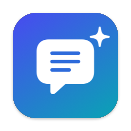

<div align="center">



<h1>Agent Assistant</h1>

<h3>在 Mac 上任意选中文字，一点就翻译或提问。</h3>

<p>轻量的 macOS 菜单栏划词助手，由本机已登录的 Claude Code 或 Codex 回答，不需要服务器，也不需要 API key。</p>

[](Info.plist)
[](#安装)
[](Sources)
[](LICENSE)

[English](README.md) · **简体中文**

[安装](#安装) · [使用](#使用) · [设置窗口](#设置窗口) · [响应时间](#响应时间实测) · [工作方式](#工作方式) · [开发](#开发)

</div>

在网页、PDF 和各种应用里选中一段文字，鼠标旁出现「翻译 / 提问」，点一下就由这台 Mac 上已登录的 **Claude Code** 或 **Codex** 回答，还能接着追问。

- 原生 AppKit + SwiftUI，安装包约 3 MB（含 Apple 芯片与 Intel 两份程序），平时只等鼠标事件，几乎不占资源。
- 直接调用本机命令行工具，沿用它们的登录和额度。不需要另开服务，也不需要 API key。
- 只有点了「翻译」或发出问题时，原文才会交给所选模型。只是选中文字时什么都不发。
- 界面目前是中文。译文语言可选简体中文、繁體中文、English、日本語、한국어、Français、Deutsch、Español。

## 安装

1. 需要 macOS 13 及以上版本和 Apple Command Line Tools。运行 `bash build.sh`，会生成 `dist/Agent Assistant.app`，同时支持 Apple 芯片和 Intel 芯片。
2. 把它拖到「应用程序」（或 `~/Applications`），双击打开。菜单栏会出现一个取景框图标。
3. 第一次打开会弹出设置窗口。点「前往授权」，在「系统设置 → 隐私与安全性 → 辅助功能」里打开 Agent Assistant 的开关。不用重启，设置页会自动变成「已允许辅助功能」。
4. 本机要装好并登录至少一个命令行工具：Claude Code（`claude auth login`）或 Codex（`codex login`）。在设置的「模型」页点「检测」可以确认。

**为什么重新构建后不用重新授权**：辅助功能授权认的是程序签名。第一次构建时，`signing.sh` 会在 `~/.agent-assistant/signing/` 生成一张本机自签名证书，之后每次都用它签名，签名不变，授权就一直有效。如果改用临时签名（`codesign -s -`），每次构建签名都会变，系统设置里的开关还显示"已打开"，实际已经失效。

## 使用

- **划词**：拖选或双击文字，松开鼠标后点「翻译」立即出译文，点「提问」先打开输入框。浮窗里可以一直追问，每次请求都带上原文和最近八轮问答。
- **读不到选区时**：Chrome 自带的 PDF 阅读器、刚打开的网页、飞书等应用，不向系统提供选中的文字。这时助手会向该应用发一次 ⌘C 取词，取完立刻把剪贴板恢复原样。设置里可以关掉这一项。在 Finder、密码框里，以及拖动窗口、按钮、滚动条时，不会这样做。
- **系统「服务」菜单**：在支持服务的应用里选中文字，右键 →「服务」→「用 Agent Assistant 翻译 / 提问」。
- **剪贴板入口**：先 ⌘C，再从菜单栏点「翻译剪贴板文字」或「用剪贴板文字提问…」。这两个入口不需要辅助功能权限。

## 设置窗口

| 页面 | 内容 |
| --- | --- |
| 划词 | 是否显示浮条、授权状态、⌘C 取词开关、译文语言、剪贴板入口 |
| 模型 | 选 Claude Code 或 Codex、模型、推理强度（effort）。下面直接显示这个组合实测的响应时间。还有检测登录状态的按钮 |
| 响应时间 | 「模型 × 推理强度」矩阵，每格是 3 次请求的中位耗时（秒）。绿色越深越快，「额度」表示当时额度已用尽，蓝框是当前在用的组合。**点格子就切换到那个组合**。右上角可以测当前组合 |

菜单栏的「响应时间…」直接打开第三页。

## 响应时间实测

2026-11-26 实测。固定把 `The library opens at nine.` 译成简体中文，每个组合连续请求 3 次，从发出请求计时到收到完整译文，包含命令行工具的启动时间。154 个组合中，122 个三次全部成功，32 个因额度用尽没取得结果（当时 Codex 额度用完，Fable 不在所用的订阅套餐里）。

- 最快的是 Sonnet 5.5，各档中位数 3.3–3.6 秒；Haiku 5.5 约 3.8–5.4 秒。
- Claude 的其他模型大多在 4–6 秒，Codex 各模型大多在 6–9 秒。
- 推理强度对这种短句翻译影响很小。

原始数据在 [`benchmarks/2026-11-26/results.json`](benchmarks/2026-11-26/results.json)，表格在 [`benchmarks/2026-11-26/响应时间-全部组合.xlsx`](benchmarks/2026-11-26/响应时间-全部组合.xlsx)。这批数据是通过 [Paper_Mind](https://github.com/ZJU-OmniAI/Paper_Mind) 的本机桥接测的，也会被 App 的响应时间页读入。桥接同样是每次请求启动一次命令行工具，所以耗时可以直接比较。

## 工作方式

每次请求都在临时目录里启动一次命令行工具，原文和对话从标准输入传入，结束后删除临时目录。点「停止」会结束整组进程。

- **Claude Code**：`claude -p --output-format json`，关闭工具、MCP、斜杠命令和 hooks，不保存会话。
- **Codex**：`codex exec --json --ephemeral`，只读沙箱，忽略用户配置，关闭命令执行、网页搜索和多智能体。
- **找命令行工具**：搜索 PATH、`~/.local/bin`、Homebrew、nvm，以及 ChatGPT.app 自带的 Codex。找到多份时用 `--version` 最新且能运行的一份，旧的 npm 版本不会挡住新模型。
- **环境**：从 Finder 打开的 App 只有很少的环境变量。助手会从登录 shell 读取 `PATH` 和代理设置（`HTTP_PROXY`、`HTTPS_PROXY`、`ALL_PROXY`、`NO_PROXY` 及小写形式），其他变量不读，所以终端里能用的代理这里也能用。
- **模型列表**：从命令行工具自己读取（Claude 的 `initialize`，Codex 的 `app-server model/list`），不产生对话，也不消耗额度。

可以用 `AGENT_ASSISTANT_CLAUDE_BIN`、`AGENT_ASSISTANT_CODEX_BIN` 指定命令行工具路径。

## 开发

```
Sources/
  App.swift             菜单栏、浮条、对话浮窗、设置窗口
  Selection.swift       全局鼠标监听、辅助功能取词、⌘C 兜底
  AssistantView.swift   对话浮窗与会话
  Backend.swift         调用 Claude Code / Codex、错误归类、模型目录
  Subprocess.swift      子进程（独立进程组）、登录 shell 环境、找最新版命令行工具
  Latency.swift         响应时间测试与记录
  ResponseTimeView.swift / SettingsView.swift   设置窗口
Tests/                  用假的 claude / codex 命令测试后端
tools/make-icon.swift   生成 assets/AppIcon.iconset
```

- 测试：`bash Tests/run.sh`。测试用两个假命令行工具，覆盖找最新版、模型目录、两种工具的生成和参数、额度和登录错误、停止时清掉整组进程、中途换模型、响应时间记录。
- 取词调试：`defaults write org.agent-assistant.app debugSelection -bool true`，再运行 `log stream --predicate 'process == "AgentAssistant"'`，可以看到每次划词走了哪条路径、花了多久。用完记得 `defaults delete org.agent-assistant.app debugSelection`。

欢迎提 [Issue](https://github.com/ZJU-OmniAI/Agent_Assistant/issues) 和 Pull Request。

## 许可

[MIT](LICENSE)。Claude Code、Codex 及其服务仍遵守各自的条款。
